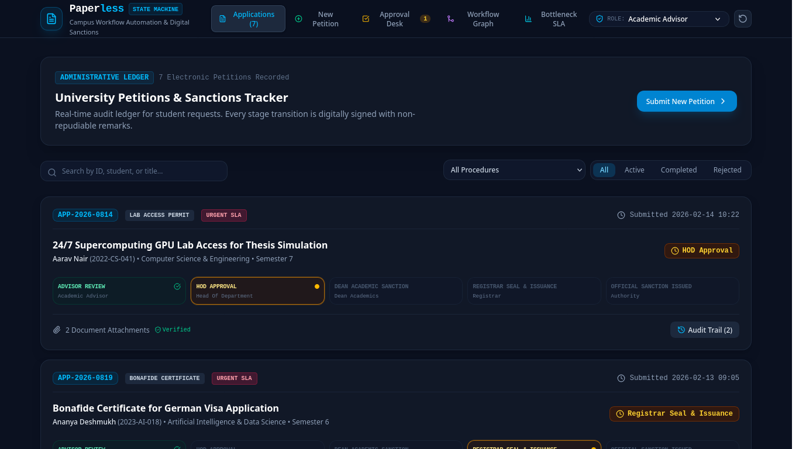

# Paperless — University Administrative Workflow State Machine

> Formal Deterministic Finite Automaton (DFA) state machine and digital sanction ledger automating multi-tier academic petitions with zero server footprint.



## Overview

University administrative procedures—medical leave attendance waivers, bonafide verification certificates, after-hours supercomputing laboratory access, double-blind grade re-evaluations, and high-value hardware requisitions—traditionally suffer from physical paper bottlenecks, ambiguous sanction authorities, and zero audit visibility.

**Paperless** provides a client-side administrative workflow engine governed by formal finite state machine transitions, role-based authorization guards, immutable audit event trails, and operational bottleneck telemetry.

---

## Key Features

- **Formal State Machine Engine**:
  - Linear progression: `Submitted` $\rightarrow$ `Advisor Review` $\rightarrow$ `HOD Approval` $\rightarrow$ `Dean Review` $\rightarrow$ `Registrar Seal` $\rightarrow$ `Completed`.
  - Exception and sink states: `Terminal Rejection` and `Revision Needed` (non-terminal amendment loopback).
  - Explicit role-based authority guards preventing unauthorized approvals.
- **Role-Based Persona Switcher**:
  - Test the platform seamlessly across 5 administrative personas: *Student*, *Academic Advisor*, *Head of Department (HOD)*, *Dean (Academics)*, and *Registrar (Super Authority)*.
- **Administrative Approval Desk**:
  - Review queue tailored specifically to the active persona's signing authority.
  - Inspect cryptographic document attachments, safety agreements, and stated academic purpose.
  - One-click *Digitally Sign & Approve*, *Request Revision*, or *Reject Petition* with mandatory audit remarks.
- **Application Tracker & Audit Trail**:
  - Searchable ledger of all student petitions with urgency tags (`Normal` vs `Urgent SLA`).
  - Visual 5-stage progress indicator with active status pulse.
  - Deep audit history modal detailing timestamped transitions, reviewer identities, and sanction remarks.
- **E-Petition Submission Studio**:
  - Adaptive form builder supporting 5 university administrative categories.
  - Document attachment validator with verification seals.
- **SLA & Bottleneck Operations Telemetry**:
  - Computes average dwell time (hours spent per stage), completion throughput, and rejection drop-off rates.
  - Highlights highest-latency desks (e.g. Dean Sanction vs Registrar Seal).
- **Local Persistence & Reset**:
  - All state transitions, newly submitted petitions, and audit logs persist in browser `localStorage` with a 1-click reset-demo-data option.

---

## Technical Stack

| Layer | Technology |
|---|---|
| Framework | React 19 + TypeScript |
| Build System | Vite |
| Styling | Tailwind CSS v4 |
| State Management | Zustand with Local Storage Persistence |
| Icons | Lucide React |
| Testing | Vitest |
| Engine | Deterministic Finite Automaton (DFA) Transition Engine |

---

## Getting Started

### Prerequisites

- Node.js $\ge 18$
- pnpm $\ge 8$

### Installation & Run

```bash
# Clone the repository
git clone git@github.com:Sanyam-Ahuja/paperless.git
cd paperless

# Install dependencies
pnpm install

# Start development server
pnpm dev

# Run Vitest test suite
pnpm test

# Build for production
pnpm build
```

---

## State Transition Automaton

```text
               [ Draft ]
                  │
                  ▼
             [ Submitted ]
                  │
                  ▼
         [ Advisor Review ] ◄────────────┐
            │           │                │
            ▼ (Approve) ├──► [ Reject ]  │
         [ HOD Approval ]                │ (Revision)
            │           │                │
            ▼ (Approve) ├──► [ Reject ]  │
         [ Dean Review ]                 │
            │           │                │
            ▼ (Approve) ├──► [ Reject ]  │
        [ Registrar Seal ] ──────────────┘
            │
            ▼
       [ Completed ]
```

---

## License

MIT © 2026 Paperless. Built for Smart Campus & Student Life Portfolio.
